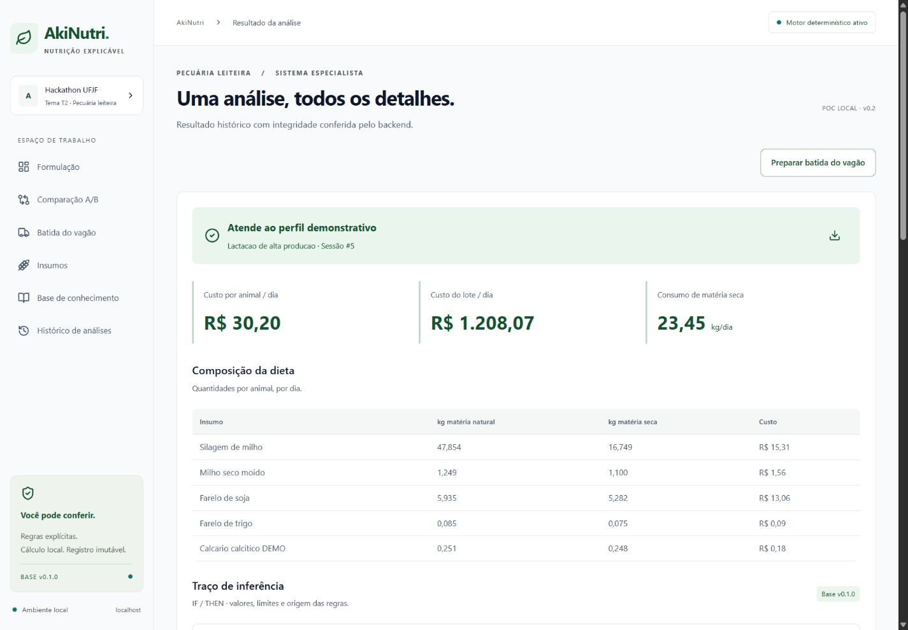

# AkiNutri

Sistema especialista para formular e conferir dietas de bovinos leiteiros. O AkiNutri calcula a dieta de menor custo para um grupo de produção e mostra quais restrições nutricionais e limites de inclusão influenciaram o resultado.

## Origem do projeto

O MVP foi desenvolvido em equipe no **Hackathon RERUM 2026**, no contexto da **XXVIII Semana da Computação da UFJF**. A implementação inicial foi registrada no Git entre **20 e 22 de outubro de 2026**, em **três dias de desenvolvimento**. A programação da [Semana do ICE 2026](https://www2.ufjf.br/ice/2026/10/09/semana-ice-2026/) ocorreu de 19 a 23 de outubro. Esta versão inclui revisões posteriores ao evento.



## O que a aplicação faz

- Formula dietas de menor custo e verifica dietas já utilizadas pelo lote.
- Estima o consumo de matéria seca com entradas explícitas e calcula o custo por animal e para o grupo.
- Explica quais regras foram atendidas, apresenta preços sombra e ajuda a identificar restrições em cenários inviáveis.
- Simula mudanças de preço e indisponibilidade de insumos, mantém um histórico auditável e calcula quantidades para a batida do vagão.

## Como funciona

O frontend usa **React e Vite**. A API usa **Python, FastAPI, SQLAlchemy e SQLite**. O motor seleciona o perfil e transforma as regras em restrições de programação linear para o **SciPy/HiGHS**. As variáveis são kg de matéria seca por animal/dia. O preço de cada ingrediente é convertido de R$/kg de matéria natural para R$/kg de matéria seca antes da otimização.

Os perfis e as composições de exemplo são simplificados para fins didáticos. O resultado depende dos preços, da composição e dos limites informados. O protótipo requer revisão técnica para aplicação em campo.

## Executar localmente

Requisitos do projeto: Python 3.12 e Node.js 22. Em um clone novo, a partir da raiz do repositório, execute no PowerShell:

```powershell
cd .\akinutri
py -3.12 -m venv .venv
.\.venv\Scripts\python.exe -m pip install -r backend\requirements.txt
Copy-Item .env.example .env
.\.venv\Scripts\python.exe -c "from pathlib import Path; import secrets; p=Path('.env'); p.write_text(p.read_text(encoding='utf-8-sig').replace('AKINUTRI_JWT_SECRET=CHANGE_ME', 'AKINUTRI_JWT_SECRET='+secrets.token_hex(32)), encoding='utf-8')"
cd .\frontend
npm ci
npm run build
cd ..
.\start.ps1
```

Em uma instalação já configurada, execute apenas o script de inicialização dentro de `akinutri`. Acesse [AkiNutri](http://localhost:8000/) ou [Swagger](http://localhost:8000/docs). O [guia de instalação](akinutri/README.md) inclui Linux/macOS, preparação dos dados fictícios e comandos de teste.

## Documentação

- [Arquitetura](akinutri/docs/ARQUITETURA.md)
- [Motor especialista e regras](akinutri/docs/RERUM-MOTOR.md)
- [Testes e validação](akinutri/docs/TESTES.md)

## Publicação online

Uma demonstração estática pode reaproveitar a prévia da dieta com resultados pré-calculados. Para publicar a aplicação completa, a arquitetura mais simples é servir React e FastAPI na mesma origem, com HTTPS, um segredo de sessão próprio e um volume persistente para o SQLite. A versão local restringe o servidor, a API e as origens aceitas a localhost. A publicação exige configurar esses pontos e usar uma base separada com dados fictícios para a demonstração.

### Demo estática para o portfólio

A partir de `akinutri/frontend`, use `npm ci` e `npm run build:portfolio`. O resultado em `dist-portfolio` contém somente a página estática e seus recursos. Para testar em desenvolvimento, execute `npx vite portfolio` e abra o endereço exibido no terminal.

No GitHub, configure **Settings → Pages → Build and deployment → Source → GitHub Actions**. Após enviar as alterações para `main`, o workflow **AkiNutri demo** publica a prévia. Também é possível executá-lo manualmente pela aba **Actions**. A implantação bem-sucedida exibe a URL pública.
