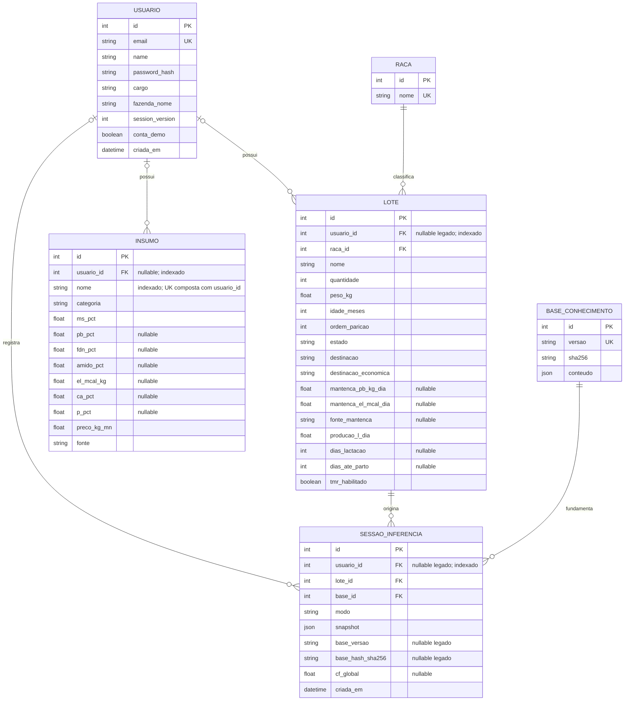

# Banco de dados — AkiNutri v0.2.0

Fonte: `backend/app/models.py` e `backend/app/database.py`. SQLite local com SQLAlchemy; chaves estrangeiras habilitadas por `PRAGMA foreign_keys=ON`.

## Diagrama entidade-relacionamento

Nomes de domínio: USUARIO = `users`, LOTE = `lotes`, INSUMO = `insumos`, SESSAO_INFERENCIA = `sessoes_inferencia`. O diagrama resume o núcleo; raças, bases, resultados e grupos complementam o modelo.

Os insumos utilizados por sessão são copiados no snapshot JSON: não existe uma FK direta entre `insumos` e `sessoes_inferencia`, nem tabela associativa desses itens. Grupos de produção também são copiados no snapshot. A cardinalidade opcional de proprietário reflete os campos nullable do esquema, não autorização de acesso anônimo.

## Chaves, índices e integridade

- Todas as entidades representadas têm PK inteira `id`.
- `users.email` é único e indexado; `racas.nome` e `bases_conhecimento.versao` são únicos.
- `insumos` tem unicidade composta `(usuario_id, nome)` e índice por nome. SQLite permite múltiplos NULL nessa restrição; a unicidade do catálogo global exige também controle da aplicação.
- `usuario_id` é FK indexada nos registros privados. `lotes.raca_id`, `sessoes_inferencia.lote_id` e `base_id` são FKs. Não há unicidade de nome de lote.
- Fora do recorte, `resultados_dieta.sessao_id` é único; grupos têm `(usuario_id, nome)` único e animais têm `(usuario_id, brinco)` único. Históricos de dietas/movimentações validam períodos.

## Isolamento SaaS multi-tenant

Cada conta funciona como um tenant no mesmo SQLite. O JWT resolve o usuário e `get_scoped_db` fixa `db.info['usuario_id']`; predicados ORM restringem consultas e escritas. IDs de outros tenants não autorizam acesso. Não se trata de Row-Level Security nativa do SQLite.

Registros legados sem proprietário ficam fora das consultas privadas. A exceção deliberada é o catálogo compartilhado de insumos com `usuario_id IS NULL`: pode ser lido, mas usuários comuns editam apenas seus insumos privados. A API valida também lote, grupo e sessão do usuário autenticado.

## NULL, zero e auditoria

`pb_pct`, `fdn_pct`, `amido_pct`, `el_mcal_kg`, `ca_pct` e `p_pct` admitem NULL para registrar composição desconhecida. Isso não autoriza formular presumindo zero: composição incompleta aciona `dados_insuficientes`, com a relação dos nutrientes faltantes. Exclusão de ingrediente incompleto exige solicitação explícita e fica no traço.

`0.0` significa teor declarado igual a zero e é válido: por exemplo, PB, FDN, amido e energia de um suplemento mineral. Não substitua ausência de laudo por zero. MS deve ser maior que zero; teores negativos são rejeitados pelos DTOs. Validações fisiológicas adicionais pertencem à API, não a CHECKs de todas as colunas.

O snapshot preserva lote, grupo, alimentos/composição/preços, entradas, base e hash; quando aplicável, preserva a estimativa de CMS. Resultados e explicações são registros separados. Hashes canônicos SHA-256 e recálculo verificam consistência na leitura. Triggers SQLite rejeitam UPDATE e DELETE de sessões, resultados, explicações, bases e regras publicadas. Alterações futuras no catálogo não reescrevem a dieta histórica. Campos de metadados nullable acomodam sessões antigas sem inventar hashes retroativos.

SHA-256 permite detectar alterações; não é assinatura digital autenticada nem impede adulteração por administrador com controle total do banco e das triggers.

## Verificação do diagrama

ERD aceito pelo parser Mermaid 11 e renderizado em SVG com Chromium em 22/10/2026, com conferência visual sem erros de sintaxe. A versão exportada está em [docs/database-erd.svg](docs/database-erd.svg); a fonte de referência permanece no bloco Mermaid acima.
