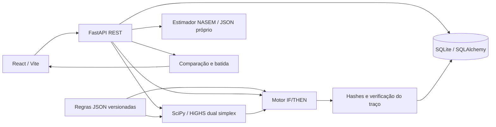

# AkiNutri · Nutrição explicável para pecuária leiteira

POC local do Hackathon UFJF 2026, Tema T2. React/Vite + FastAPI + SQLite/SQLAlchemy + SciPy/HiGHS. Regras nutricionais explícitas em JSON; nenhum cálculo ou decisão depende de LLM.

## Executar

Nesta máquina, dependências e build estão preparados. No PowerShell, dentro de `akinutri`:

```powershell
.\start.ps1
```

Abra **http://127.0.0.1:8000** ou **http://localhost:8000**. Swagger: **http://localhost:8000/docs**. `Ctrl+C` encerra o servidor. Apenas um processo pode ocupar a porta 8000.

### Instalação em outra máquina

Requisitos: Python 3.12 e Node.js 22 com npm. Na pasta `akinutri`:

```powershell
py -3.12 -m venv .venv
.\.venv\Scripts\python.exe -m pip install -r backend\requirements.txt
Set-Location frontend
npm ci
npm run build
Set-Location ..
.\start.ps1
```

A internet só é necessária para instalar dependências. Não há CDN, fontes externas, telemetria ou API de IA no runtime. O build é servido pelo próprio FastAPI, na mesma origem. O script de build copia também os assets do Swagger UI para servir `/docs` localmente, sem validador externo.

Linux/macOS:

```bash
python3.12 -m venv .venv
.venv/bin/python -m pip install -r backend/requirements.txt
cd frontend
npm ci
npm run build
cd ../backend
../.venv/bin/python -m uvicorn app.main:app --host 127.0.0.1 --port 8000
```

### Desenvolvimento

Em `backend`, execute `..\.venv\Scripts\python.exe -m uvicorn app.main:app --reload --host 127.0.0.1 --port 8000`. Em outro terminal, dentro de `frontend`, execute `npm run dev` e abra http://localhost:5173. O proxy do Vite encaminha `/api` ao backend. O build deve existir antes de iniciar a API para disponibilizar a interface na porta 8000.

## Fluxo de uso

1. **Lote:** carregue um cenário ou preencha o formulário, incluindo raça, peso, idade, parição, fase, destinação e produção. Salve ou selecione um lote existente.
2. **Consumo:** informe CMS manualmente ou abra o estimador opcional, complete as entradas técnicas e aplique a sugestão. Aplicação e ajuste manual são ações explícitas.
3. **Insumos:** selecione alimentos; edite preços por kg MN diretamente na tabela; defina limites de inclusão em kg MS. Os preços da análise não alteram o catálogo.
4. **Verificar:** informe a dieta atual em kg MN/animal/dia e registre o diagnóstico.
5. **Formular:** mantenha os mesmos fatos e escolha “Formular menor custo”. O LP usa as mesmas regras e pós-verifica o resultado.
6. **Explicar:** abra os acordeões para conferir valor, intervalo, estado, fonte, custos marginais e preços sombra.
7. **Comparar A/B:** escolha uma sessão manual e uma formulação. A API exige igualdade de lote, base, consumo, manejo, composição, preços e limites. Divergência retorna 409; uma comparação não é feita entre contextos diferentes.
8. **Batida do vagão:** selecione uma dieta que atenda ao perfil demonstrativo, informe batidas/dia e capacidade opcional. Reordene os insumos conforme orientação do responsável e imprima ou exporte o JSON exato.

O histórico preserva sessões e verifica sua integridade ao abri-las. O botão “Usar na verificação” transfere quantidades sem arredondar, para conferir a formulação no fluxo manual.

## Arquitetura



| Arquivo / módulo | Responsabilidade |
|---|---|
| `backend/app/main.py` | REST, transações, integração e frontend estático |
| `schemas.py`, `models.py`, `database.py` | DTOs, entidades, SQLite e proteção append-only |
| `engine_rules.py` | Seleção de perfis e verificação determinística |
| `engine_solver.py` | LP, custos marginais e preços sombra |
| `engine_intake.py` | Estimador técnico de CMS |
| `audit.py` | Hash canônico e revalidação do traço |
| `reports.py` | Comparação compatível e quantidades por batida |
| `backend/rules/base_v0.1.0.json` | Perfis e limites nutricionais imutáveis |
| `backend/rules/intake_nasem2021_v1.json` | Coeficientes, fonte e versão do estimador |
| `frontend/src/hooks/useWorkspace.js` | Estado, chamadas de API e origem do consumo |
| `frontend/src/components/` | Lote, alimentos, traço, comparação, vagão e catálogo |

### Modelo LP e unidades

Variável `x_i`: kg MS do alimento por animal/dia. Custo `c_i = preço_kg_MN / fração_MS`.

```text
minimizar Σ(c_i × x_i)                 [R$/animal/dia]
Σ x_i = consumo alvo                  [kg MS/animal/dia]
inclusão mínima_i ≤ x_i ≤ inclusão máxima_i
limite mínimo × Σ x_i ≤ Σ(teor_i × x_i)
Σ(teor_i × x_i) ≤ limite máximo × Σ x_i
```

Com consumo fixo, minimizar custo diário equivale a minimizar custo por kg MS. Os teores percentuais são pontos percentuais (17 = 17%); energia é Mcal/kg MS. FDN de volumosos usa FDN apenas dos volumosos no numerador e MS total no denominador. `kg MN = kg MS / fração MS`.

HiGHS usa `highs-ds`, tolerâncias de viabilidade de 1e-9 e limite de execução de 10 s. Há tratamento de falhas numéricas e valores não finitos. A solução é pós-verificada com tolerância do JSON, 1e-6, sem arredondar e sem relaxar restrições silenciosamente.

Custos marginais de inclusão são por kg MS adicional no limite. Preços sombra das restrições percentuais são por unidade do lado direito da inequação linear montada, **não** por ponto percentual de nutriente. São derivadas locais; não garantem economia para mudanças grandes ou alterações na base ótima.

### CMS / NASEM 2021

Implementa a **equação 2-1** de fatores animais para Holandesas em lactação: peso vivo, energia diária do leite, dias em lactação, escore corporal (1–5) e fração de multíparas (0–1). [Fonte NASEM](https://www.ncbi.nlm.nih.gov/books/NBK600610/).

A energia pode ser informada diretamente em Mcal/dia ou obtida multiplicando **leite já corrigido** pela energia de referência declarada. O valor inicial de referência é 0,7 Mcal/kg; o sistema não converte silenciosamente litros de leite bruto em leite corrigido. ECC 3 e fração de multíparas são entradas iniciais editáveis, não medições automáticas.

Não extrapola para Gir, outras raças, vacas secas ou mais de 368 dias em lactação. Esses lotes continuam usando CMS manual. A equação é uma estimativa populacional, não garantia de consumo. O perfil nutricional do MVP continua excluindo o início da lactação, mesmo quando a equação pode produzir uma estimativa.

Ao aplicar uma sugestão, o servidor recalcula e confere o vínculo com os fatos do lote. Entradas, coeficientes, fonte, hash do modelo e resultado ficam no snapshot. Ajustar CMS manualmente remove a origem estimada da próxima análise.

### Auditoria e migração

- Banco padrão: `backend/akinutri.db`; configuração opcional: `AKINUTRI_DATABASE_URL` para outro SQLite.
- A migração preservou o banco anterior. Backups de fonte e banco anteriores à evolução estão em `backups/`, ignorados pelo Git.
- A base nutricional 0.1.0 foi preservada sem alteração de conteúdo. Novas regras exigem nova versão.
- Sessões, resultados, explicações e bases publicadas recebem triggers SQLite que rejeitam UPDATE/DELETE. Catálogo de insumos continua editável.
- Sessões novas guardam SHA-256 do snapshot e do resultado; a leitura também confere a base e recalcula perfis, nutrientes e traço. Sessões anteriores são conferidas com base e recálculo, sem inventar hashes históricos que não existiam.
- SHA-256 detecta inconsistências; não é assinatura digital autenticada. Não protege contra um administrador que reescreva banco, triggers e hashes.
- Dados estruturados relacionais com itens preservados em snapshots JSON. `create_all` não substitui migrações de esquema.
- Mesmo ambiente e fatos produzem os mesmos resultados nos testes. Empates podem mudar de solução entre versões do solver; método, versões e fatos são preservados.

### Comparação e vagão

A economia é `(custo manual diário do lote − custo formulado diário do lote) × dias`. Preços e consumo são constantes na projeção. Valores negativos são apresentados como custo adicional. Não calcula receita ou lucro. Se a dieta manual viola regras, a UI informa que não há equivalência nutricional demonstrada.

Na batida: `kg MN/batida = kg MN/animal/dia × animais / batidas_dia`. Capacidade insuficiente retorna 422. O operador define a sequência; a listagem inicial por ID **não é protocolo técnico de mistura**. Não adiciona automaticamente água, perdas ou sobras. A tela usa três casas decimais e o JSON preserva a precisão integral.

## API

| Método | Rota | Finalidade |
|---|---|---|
| GET | `/api/health`, `/api/racas` | Saúde e raças |
| GET / POST | `/api/lotes` | Consultar e cadastrar lotes |
| GET / POST / PUT | `/api/insumos`, `/api/insumos/{id}` | Catálogo |
| GET | `/api/regras` | Base e hash |
| POST | `/api/estimar-cms` | Sugestão técnica opcional |
| POST | `/api/verificar`, `/api/formular` | Inferência e LP |
| GET | `/api/sessoes`, `/api/sessoes/{id}` | Histórico e integridade |
| POST | `/api/comparar` | Comparação contextual A/B |
| POST | `/api/sessoes/{id}/batida` | Relatório de carregamento |

DTO inválido: 422; ID ausente: 404; conflito de contexto/nome/integridade: 409. Inviabilidade ou falta de cobertura são resultados de domínio, registrados com HTTP 200. Rotas REST desconhecidas não são respondidas com o HTML da interface. Navegação da UI usa hash, como `/#comparacao`.

## Testes e qualidade

Em `backend`:

```powershell
..\.venv\Scripts\python.exe -m pytest -q
```

Em `frontend`:

```powershell
npm test
npm run build
npm run format:check
```

Formatação Python opcional: instale `backend/requirements-dev.txt` e execute `python -m black --check app tests` em `backend`.

Veja [testes](docs/TESTES.md), [arquitetura](docs/ARQUITETURA.md), [skills aplicadas e limitações](docs/SKILLS.md), [contrato visual](.interface-design/system.md) e [apresentação](docs/APRESENTACAO.md).

## Limites científicos e operacionais

Perfis e alimentos iniciais são **demonstrativos e não validados para prescrição**. Parte das faixas é adaptação didática, explicitada no JSON. Não reproduz integralmente NRC/NASEM/CNCPS. Não cobre proteína metabolizável, DCAD, vitaminas, biodisponibilidade ou requerimentos fisiológicos individualizados. Preços/composição do seed devem ser substituídos por análises e cotações locais.

Perfis de lactação exigem TMR, partícula adequada, milho seco predominante e ≥60 dias em lactação; alta produção ≥30 L/dia, moderada <30. Seca distante exige mais de 21 dias até parto. Não cobre transição pré-parto. Raça, peso, idade e parição são auditados, mas não modificam diretamente esses limites simplificados.

Referências de contexto: [NASEM — fibra](https://www.ncbi.nlm.nih.gov/books/NBK600592/), [Penn State — amido](https://extension.psu.edu/carbohydrate-nutrition-for-lactating-dairy-cattle), [Penn State — proteína](https://extension.psu.edu/from-feed-to-milk-understanding-rumen-function), [SciPy — HiGHS](https://docs.scipy.org/doc/scipy/reference/optimize.linprog-highs.html).

Aplicação para uso local em loopback, sem autenticação. A interface segue critérios de acessibilidade e recebe verificações de teclado, contraste e reflow; isso não equivale a certificação WCAG completa ou prontidão industrial validada.
