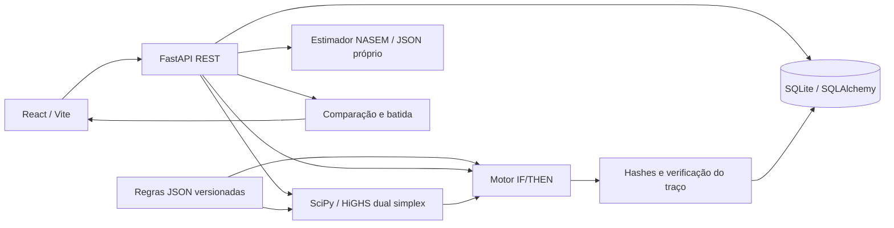

# AkiNutri · Nutrição explicável para pecuária leiteira

POC local do Hackathon UFJF 2026, Tema T2. React/Vite + FastAPI + SQLite/SQLAlchemy + SciPy/HiGHS. Regras nutricionais explícitas em JSON; nenhum cálculo ou decisão depende de LLM.

## Executar

Os serviços escutam somente em loopback. O frontend usa `http://localhost:5173`, a API `http://localhost:8000` e o banco SQLite é um arquivo local em `backend/akinutri.db`. Não configure endereços públicos, serviços externos ou banco hospedado.

Copie `.env.example` para `.env` em `akinutri`, e `frontend/.env.example` para `frontend/.env.local`. Substitua `AKINUTRI_JWT_SECRET=CHANGE_ME` por uma chave aleatória local de pelo menos 32 bytes (em Linux/macOS, `openssl rand -hex 32`). O exemplo de segredo é intencionalmente inválido e a API recusa iniciar autenticação até que seja trocado. Esses arquivos locais são ignorados pelo Git.

Nesta máquina, dependências e build estão preparados. No PowerShell, dentro de `akinutri`:

```powershell
.\start.ps1
```

Abra **http://localhost:8000**. Swagger: **http://localhost:8000/docs**. `Ctrl+C` encerra o servidor. Apenas um processo pode ocupar a porta 8000.

### Instalação em outra máquina

Requisitos: Python 3.12 e Node.js 22 com npm. Na pasta `akinutri`:

Login para testes:  carlos@fazendaouroverde.com.br / senha123

```powershell
if (-not (Test-Path .env)) { Copy-Item .env.example .env }
if (-not (Test-Path frontend\.env.local)) { Copy-Item frontend\.env.example frontend\.env.local }
py -3.12 -m venv .venv
.\.venv\Scripts\python.exe -m pip install -r backend\requirements.txt
Set-Location frontend
npm ci
npm run build
Set-Location ..
.\start.ps1
```

A internet só é necessária para instalar dependências. Não há CDN, fontes externas, telemetria ou API de IA no runtime. O build é servido pelo próprio FastAPI, na mesma origem. O script de build copia também os assets do Swagger UI para servir `/docs` localmente, sem validador externo.

Linux/macOS:

```bash
test -f .env || cp .env.example .env
test -f frontend/.env.local || cp frontend/.env.example frontend/.env.local
python3.12 -m venv .venv
.venv/bin/python -m pip install -r backend/requirements.txt
cd frontend
npm ci
npm run build
cd ../backend
../.venv/bin/python -m app
```

### Desenvolvimento

Na raiz `akinutri`, inicie a API local com `./start.sh` (Linux/macOS) ou `.\start.ps1` (PowerShell). Para desenvolvimento do frontend, abra outro terminal, entre em `frontend` e execute `npm run dev`; acesse http://localhost:5173. O frontend chama a API diretamente em `http://localhost:8000`, e o backend aceita CORS apenas das origens locais configuradas. O build deve existir antes de iniciar a API para disponibilizar a interface na porta 8000. Caminhos relativos de SQLite são resolvidos a partir de `backend`, independentemente da pasta de inicialização.

### Contas e autenticação

O cadastro em `/register` usa `POST /api/auth/register` com `nome`, `email`, `senha`, `cargo` (produtor/zootecnista) e `fazenda_nome`; exige senha com ao menos 8 caracteres e rejeita e-mail já utilizado. Após salvar o hash bcrypt via Passlib, autentica a nova conta automaticamente. O login em `POST /api/auth/login` verifica o hash via Passlib/bcrypt, inclusive hashes bcrypt existentes. Ambos retornam `access_token` / `token_type=bearer` e também emitem JWT em cookie `HttpOnly`, `SameSite=Lax`, com validade de uma hora (30 dias se “Manter conectado” estiver marcado no login). O segredo de assinatura não tem valor padrão: configure `AKINUTRI_JWT_SECRET` com pelo menos 32 bytes aleatórios antes de iniciar o backend. Por exemplo, em Linux/macOS:

```bash
export AKINUTRI_JWT_SECRET="$(openssl rand -hex 32)"
```

Em PowerShell, defina `$env:AKINUTRI_JWT_SECRET` para um valor aleatório forte antes de iniciar o servidor. Em produção, use HTTPS e configure `AKINUTRI_COOKIE_SECURE=true`; em desenvolvimento local HTTP, o padrão `false` permite que o navegador aceite o cookie.

Crie uma conta administrativa pelo terminal do backend; a senha é solicitada sem eco e nunca deve ser passada como argumento:

```bash
../.venv/bin/python -m app.create_user --email pessoa@exemplo.com --name "Nome da pessoa"
```

No Windows, use `..\.venv\Scripts\python.exe -m app.create_user --email pessoa@exemplo.com --name "Nome da pessoa"`. A inicialização cria tabelas ausentes e aplica migração aditiva dos campos de autenticação/proprietário; contas existentes não são alteradas.

### Proteção de dados e sessão

`GET /api/auth/me` confirma a identidade e a expiração da sessão. `POST /api/auth/logout` remove o cookie e revoga os tokens existentes da conta. O frontend usa `AuthGuard`, espera a confirmação do servidor com Bearer token antes de montar o dashboard; identidades antigas em `sessionStorage` não concedem acesso. Não há atalhos de login demonstrativo.

Lotes, formulações, verificações, histórico, comparação, batidas, animais e grupos exigem autenticação. Os dados são filtrados por `usuario_id` nas consultas e vinculados à conta nas gravações. Insumos públicos são compartilhados somente para leitura; alimentos particulares podem ser cadastrados pela conta. Respostas da API usam `Cache-Control: no-store`, e operações com origem externa não autorizada são rejeitadas.

A migração adiciona proprietário e campos de perfil sem reescrever snapshots, resultados ou hashes. Registros históricos sem proprietário permanecem preservados, mas indisponíveis nas contas comuns; não são atribuídos arbitrariamente à seed. As restrições de nomes únicos preexistentes de insumos, grupos e brincos permanecem no banco.

### Popular a propriedade fictícia

A seed de referência carregada no início continua separada da propriedade fictícia, que exige uma ação explícita. Na raiz `akinutri`:

```powershell
Push-Location backend
..\.venv\Scripts\python.exe -m app.seed
Pop-Location
.\start.ps1
```

A senha padrão da conta fictícia é `senha123`, conforme o cenário solicitado. `AKINUTRI_SEED_PASSWORD` permite definir outra senha para a seed. Nas próximas execuções, contas, senhas, lotes e sessões existentes são preservados. Somente campos nutricionais ausentes nas antigas entradas reconhecidas da seed fictícia são completados com os valores fornecidos; dados personalizados não são preenchidos automaticamente. Para redefinir explicitamente somente a senha da conta da seed e revogar suas sessões, execute `python -m app.seed --reset-password` no ambiente virtual. A exigência de 8 caracteres permanece nos cadastros comuns.

Conta: `carlos@fazendaouroverde.com.br`, Dr. Carlos Eduardo de Moraes, zootecnista da Fazenda Ouro Verde fictícia. São criados três lotes (45 Holandesas, 30 Girolando e 15 vacas secas), seis insumos particulares e três análises históricas calculadas e auditadas pelo motor. As duas sessões do primeiro lote podem ser comparadas em A/B.

Os valores bromatológicos e preços recebidos são identificados como ilustrativos, sem alegar laudo ou cotação real. Os seis insumos desta seed têm composição explícita, incluindo Ca/P e os zeros fornecidos para o núcleo. Dados desconhecidos de outros cadastros continuam ausentes. O nome do núcleo não certifica uma formulação aniônica. As análises históricas preservam o catálogo e os valores congelados em seus snapshots. Não há conversão implícita de leite bruto em leite corrigido nem extrapolação para o pré-parto fora do escopo.

Nesta preparação, o banco recebeu backup em `backups/` antes da migração. As credenciais geradas estão em `seed-access.local.txt`, ignorado pelo Git.

### URLs reais

Navegação em `/`, `/login`, `/register`, `/dashboard` e `/dashboard/{akibot,comparacao,batida,insumos,regras,historico,resultado,animais}`. O fallback SPA permite recarregar cada rota. Caminhos `/api/*` continuam retornando JSON, e assets inexistentes retornam 404. O JWT fica em sessionStorage, ou localStorage ao manter conectado, e é enviado em `Authorization: Bearer <token>`; sem token validado, o guard leva a `/login` e conserva o destino para depois do login.

As fontes publicadas, os snapshots e os termos científicos exportados não são reescritos pela apresentação. A UI usa “referência” e “ilustrativo”, mantém a identificação de dados fictícios e não afirma criptografia de transporte em HTTP. Veja [validação das rotas e autenticação](docs/ROTAS-AUTH.md).

## Fluxo de uso

### AkiBot e simulação de preços

Em **AkiBot · Assistente** (`/dashboard/akibot`), escolha o perfil do lote, o CMS, os insumos, o objetivo e confira o resumo. A formulação exige um grupo ativo com parâmetros completos. O motor usa os fatos do grupo; a aplicação NASEM é recalculada ao escolhê-lo. O atalho de lactação escolhe um alimento por tipo e prioriza composição completa; inclua os minerais necessários com o botão específico. Preços são por kg de matéria natural e quantidades da verificação são por animal/dia.

No resultado de uma dieta validada, abra **E se o preço mudar? → Simular cenário**. Escolha milho +20%, soja −15% ou um insumo indisponível. A simulação usa os insumos e limites da sessão original, registra outra análise e mostra custos anterior/novo, impacto para 30 dias e mudanças nas quantidades. O catálogo e a sessão original são preservados. Um cenário inviável mostra o diagnóstico sem projetar economia. Alterações nos fatos do lote, grupo, composição ou base impedem a projeção entre contextos distintos.

A comparação A/B continua exigindo o mesmo contexto e preços; a simulação de preços é um fluxo separado. O cenário simulado fica no histórico, e **Abrir resultado completo do cenário** permite conferir o traço e preparar a batida.

### Histórico do ciclo de vida e grupos de produção

Na aba **Animais e GP** (`/dashboard/animais`), cadastre grupos nas fases Bezerril, Recria, Lactação ou Seca, depois cadastre animais com data de nascimento, identificação e grupo inicial. A movimentação registra a data de entrada em cada novo grupo e encerra o período anterior no dia precedente. Grupos e animais podem ser arquivados; os registros históricos são preservados.

Para ativar uma dieta, selecione uma formulação LP concluída e verificada, o GP e a data de início. Uma dieta nova encerra a dieta anterior do mesmo grupo no dia precedente. No perfil do animal, a linha do tempo cruza seus períodos de movimentação com as dietas ativas, mostra os ingredientes e custos diários dos snapshots registrados e acumula o custo pelo número de dias em cada período. Períodos sem dieta registrada aparecem explicitamente e têm custo nutricional contabilizado como zero; o histórico começa na primeira movimentação cadastrada, sem inferir fases anteriores.

1. **Lote:** carregue um cenário ou preencha o formulário, incluindo raça, peso, idade, parição, fase, destinação e produção. Salve ou selecione um lote existente.
2. **Consumo:** informe CMS manualmente ou abra o estimador opcional, complete as entradas técnicas e aplique a sugestão. Aplicação e ajuste manual são ações explícitas.
3. **Insumos:** selecione alimentos; edite preços por kg MN diretamente na tabela; defina limites de inclusão em kg MS. Os preços da análise não alteram o catálogo.
4. **Verificar:** informe a dieta atual em kg MN/animal/dia e registre o diagnóstico.
5. **Formular:** mantenha os mesmos fatos e escolha “Formular menor custo”. O LP usa as mesmas regras e pós-verifica o resultado.
6. **Explicar:** abra os acordeões para conferir valor, intervalo, estado, fonte, custos marginais e preços sombra.
7. **Comparar A/B:** escolha uma sessão manual e uma formulação. A API exige igualdade de lote, base, consumo, manejo, composição, preços e limites. Divergência retorna 409; uma comparação não é feita entre contextos diferentes.
8. **Batida do vagão:** selecione uma dieta que atenda ao perfil demonstrativo, informe batidas/dia e capacidade opcional. Reordene os insumos conforme orientação do responsável e imprima ou exporte o JSON exato.

O histórico preserva sessões e verifica sua integridade ao abri-las. O botão “Usar na verificação” transfere quantidades sem arredondar, para conferir a formulação no fluxo manual.

## Arquitetura



| Arquivo / módulo | Responsabilidade |
|---|---|
| `backend/app/main.py` | REST, transações, integração e frontend estático |
| `backend/app/lifecycle.py` | CRUD de grupos/animais, movimentações, dietas ativas e linha do tempo nutricional |
| `schemas.py`, `models.py`, `database.py` | DTOs, entidades, SQLite e proteção append-only |
| `engine_rules.py` | Seleção de perfis e verificação determinística |
| `engine_solver.py` | LP, custos marginais e preços sombra |
| `engine_intake.py` | Estimador técnico de CMS |
| `audit.py` | Hash canônico e revalidação do traço |
| `reports.py` | Comparação compatível e quantidades por batida |
| `backend/rules/base_v0.2.0.json` | Perfis e limites nutricionais versionados |
| `backend/rules/intake_nasem2021_v1.json` | Coeficientes, fonte e versão do estimador |
| `frontend/src/hooks/useWorkspace.js` | Estado, chamadas de API e origem do consumo |
| `frontend/src/components/` | Lote, alimentos, traço, comparação, vagão e catálogo |

### Modelo LP e unidades

Variável `x_i`: kg MS do alimento por animal/dia. Custo `c_i = preço_kg_MN / fração_MS`.

```text
minimizar Σ(c_i × x_i)                 [R$/animal/dia]
Σ x_i = consumo alvo                  [kg MS/animal/dia]
inclusão mínima_i ≤ x_i ≤ inclusão máxima_i
limite mínimo × Σ x_i ≤ Σ(teor_i × x_i)
Σ(teor_i × x_i) ≤ limite máximo × Σ x_i
```

Com consumo fixo, minimizar custo diário equivale a minimizar custo por kg MS. Os teores percentuais são pontos percentuais (17 = 17%); energia é Mcal/kg MS. FDN de volumosos usa FDN apenas dos volumosos no numerador e MS total no denominador. `kg MN = kg MS / fração MS`.

HiGHS usa `highs-ds`, tolerâncias de viabilidade de 1e-9 e limite de execução de 10 s. Há tratamento de falhas numéricas e valores não finitos. A solução é pós-verificada com tolerância do JSON, 1e-6, sem arredondar e sem relaxar restrições silenciosamente.

Custos marginais de inclusão são por kg MS adicional no limite. Preços sombra das restrições percentuais são por unidade do lado direito da inequação linear montada, **não** por ponto percentual de nutriente. São derivadas locais; não garantem economia para mudanças grandes ou alterações na base ótima.

### CMS / NASEM 2021

Implementa a **equação 2-1** de fatores animais para Holandesas em lactação: peso vivo, energia diária do leite, dias em lactação, escore corporal (1–5) e fração de multíparas (0–1). [Fonte NASEM](https://www.ncbi.nlm.nih.gov/books/NBK600610/).

A energia pode ser informada diretamente em Mcal/dia ou obtida multiplicando **leite já corrigido** pela energia de referência declarada. O valor inicial de referência é 0,7 Mcal/kg; o sistema não converte silenciosamente litros de leite bruto em leite corrigido. ECC 3 e fração de multíparas são entradas iniciais editáveis, não medições automáticas.

A equação NASEM original não é apresentada como validada para outras raças ou vacas secas. A revisão T2 acrescenta modelos experimentais identificados abaixo; DEL acima de 368 continua fora do escopo da estimativa. A equação é uma estimativa populacional, não garantia de consumo. O perfil nutricional do MVP continua excluindo o início da lactação, mesmo quando a equação pode produzir uma estimativa.

Ao aplicar uma sugestão, o servidor recalcula e confere o vínculo com os fatos do lote. Entradas, coeficientes, fonte, hash do modelo e resultado ficam no snapshot. Ajustar CMS manualmente remove a origem estimada da próxima análise.

### Auditoria e migração

- Banco padrão: `backend/akinutri.db`; configuração opcional: `AKINUTRI_DATABASE_URL` para outro SQLite.
- A migração preservou o banco anterior. Backups de fonte e banco anteriores à evolução estão em `backups/`, ignorados pelo Git.
- A base nutricional 0.1.0 foi preservada sem alteração de conteúdo. Novas regras exigem nova versão.
- Sessões, resultados, explicações e bases publicadas recebem triggers SQLite que rejeitam UPDATE/DELETE. Catálogo de insumos continua editável.
- Sessões novas guardam SHA-256 do snapshot e do resultado; a leitura também confere a base e recalcula perfis, nutrientes e traço. Sessões anteriores são conferidas com base e recálculo, sem inventar hashes históricos que não existiam.
- SHA-256 detecta inconsistências; não é assinatura digital autenticada. Não protege contra um administrador que reescreva banco, triggers e hashes.
- Dados estruturados relacionais com itens preservados em snapshots JSON. `create_all` não substitui migrações de esquema.
- Mesmo ambiente e fatos produzem os mesmos resultados nos testes. Empates podem mudar de solução entre versões do solver; método, versões e fatos são preservados.

### Comparação e vagão

A economia é `(custo manual diário do lote − custo formulado diário do lote) × dias`. Preços e consumo são constantes na projeção. Valores negativos são apresentados como custo adicional. Não calcula receita ou lucro. Se a dieta manual viola regras, a UI informa que não há equivalência nutricional demonstrada.

Na batida: `kg MN/batida = kg MN/animal/dia × animais / batidas_dia`. Capacidade insuficiente retorna 422. O operador define a sequência; a listagem inicial por ID **não é protocolo técnico de mistura**. Não adiciona automaticamente água, perdas ou sobras. A tela usa três casas decimais e o JSON preserva a precisão integral.

## API

| Método | Rota | Finalidade |
|---|---|---|
| GET | `/api/health`, `/api/racas` | Saúde e raças |
| GET / POST | `/api/lotes` | Consultar e cadastrar lotes |
| GET / POST / PUT | `/api/insumos`, `/api/insumos/{id}` | Catálogo |
| GET | `/api/regras` | Base e hash |
| POST | `/api/estimar-cms` | Sugestão técnica opcional |
| POST | `/api/verificar`, `/api/formular` | Inferência e LP |
| GET | `/api/sessoes`, `/api/sessoes/{id}` | Histórico e integridade |
| POST | `/api/comparar` | Comparação contextual A/B |
| POST | `/api/sessoes/{id}/batida` | Relatório de carregamento |

DTO inválido: 422; ID ausente: 404; conflito de contexto/nome/integridade: 409. Inviabilidade ou falta de cobertura são resultados de domínio, registrados com HTTP 200. Rotas REST desconhecidas não são respondidas com o HTML da interface. A navegação usa caminhos reais, como `/dashboard/comparacao`; favoritos antigos com hash são migrados.

## Testes e qualidade

Validação completa em PowerShell, a partir de `akinutri` (requer `backend/requirements-dev.txt` e as dependências do frontend instaladas):

```powershell
.\tools\verify.ps1
```

O comando interrompe na primeira falha e verifica Black, testes do backend com bancos isolados, Prettier, testes da interface e build de produção. Veja a [validação final](docs/VALIDACAO-FINAL.md).

Em `backend`:

```powershell
..\.venv\Scripts\python.exe -m pytest -q
```

Em `frontend`:

```powershell
npm test
npm run build
npm run format:check
```

Formatação Python opcional: instale `backend/requirements-dev.txt` e execute `python -m black --check app tests` em `backend`.

Veja [testes](docs/TESTES.md), [arquitetura](docs/ARQUITETURA.md), [skills aplicadas e limitações](docs/SKILLS.md), [contrato visual](.interface-design/system.md) e [apresentação](docs/APRESENTACAO.md).

## Limites científicos e operacionais

Perfis e alimentos iniciais são **demonstrativos e não validados para prescrição**. Parte das faixas é adaptação didática, explicitada no JSON. Não reproduz integralmente NRC/NASEM/CNCPS. Não cobre proteína metabolizável, DCAD, vitaminas, biodisponibilidade ou requerimentos fisiológicos individualizados. Preços/composição do seed devem ser substituídos por análises e cotações locais.

Perfis de lactação exigem TMR, partícula adequada, milho seco predominante e ≥60 dias em lactação; alta produção ≥30 L/dia, moderada <30. Seca distante exige mais de 21 dias até parto. Não cobre transição pré-parto. Idade e parição agora acionam a reserva de crescimento quando há valores de mantença e fonte. Destino do leite aciona pisos experimentais; raça e peso participam do estimador de CMS conforme o domínio declarado abaixo.

Referências de contexto: [NASEM — fibra](https://www.ncbi.nlm.nih.gov/books/NBK600592/), [Penn State — amido](https://extension.psu.edu/carbohydrate-nutrition-for-lactating-dairy-cattle), [Penn State — proteína](https://extension.psu.edu/from-feed-to-milk-understanding-rumen-function), [SciPy — HiGHS](https://docs.scipy.org/doc/scipy/reference/optimize.linprog-highs.html).

O login verifica credenciais e emite JWT em cookie HttpOnly; as rotas operacionais exigem a sessão e isolam os dados por conta. A aplicação permanece com execução em loopback; esta entrega não implica prontidão industrial validada. A interface segue critérios de acessibilidade e recebe verificações de teclado, contraste e reflow; isso não equivale a certificação WCAG completa ou prontidão industrial validada.

## Motor especialista RERUM

A base 0.2.0 acrescenta memória de trabalho, encadeamento direto, CF, explicações ativas e governança. Consulte [a arquitetura, a política de conflitos e os limites de validação](docs/RERUM-MOTOR.md). A revisão por especialista permanece pendente; a formulação automática de transição é bloqueada até haver parâmetros técnicos revisados.


## Base v0.2.0 - recalibração T2

A família da base é **v0.2.0**. O identificador publicado desta revisão é `0.2.0+recalibracao.1`, no arquivo `backend/rules/base_v0.2.0.json`. O conteúdo original 0.2.0 permanece em `base_v0.2.0_original.json`; o seed cria outro registro, preservando sessões e hashes históricos. Não substitua a base anterior no banco.

O motor identifica e relata conjuntamente quais restrições nutricionais foram violadas/conflitantes no modelo estrito, sem relaxá-las automaticamente. Em uma formulação inviável não existe dieta final da qual medir violações: o diagnóstico informa restrições conjuntamente incompatíveis, incluindo limites dos insumos. A certificação do conjunto irredutível depende de concluir o diagnóstico dentro do orçamento numérico; ele não precisa ser único nem ter cardinalidade mínima.

A formulação para o período de transição pré-parto (Close-Up) está intencionalmente bloqueada nesta versão (escopo de evolução futura), sendo suportados apenas os perfis de lactação e seca distante. A lactação suportada pelos perfis continua exigindo DEL >= 60 e os manejos declarados; a estimativa de CMS não amplia automaticamente esse escopo.

Desempenho: execução local determinística em tempo real, com limites explícitos de duração. Não há medição que sustente conclusão do wizard em menos de 30 segundos nem garantia de latência em qualquer equipamento.

SHA-256: **Hash de Validação de Integridade e Rastreabilidade do Conteúdo da Base de Conhecimento**. Não é assinatura digital autenticada. Os registros históricos têm triggers de proteção, mas um administrador com controle total do banco pode alterar registros e hashes.

### Hipóteses e limites da recalibração

- Idade <= 36 meses OU ordem de parição = 1 ativa uma única reserva de crescimento. O acréscimo é 10% da PB e da EL de mantença informadas, por animal/dia, com fonte obrigatória. Para PB, `delta_%MS = 0.10 * mantenca_pb_kg_dia / CMS * 100`; para EL, `delta_Mcal_kgMS = 0.10 * mantenca_el_mcal_dia / CMS`. Não se confunde mantença com a dieta inteira. Sem entradas/fonte, o sistema retorna dados insuficientes. Os valores devem representar o grupo analisado; não há cálculo fisiológico automático da mantença nem garantia de preservação de ECC.
- `destinacao` preserva leite/reprodução/dupla aptidão. O novo campo `destinacao_economica` separa leite fluido de queijo artesanal. Leite fluido mantém os limites; queijo em lactação aplica pisos experimentais PB 18% MS e FDN de volumosos 21% MS. O segundo piso mede contribuição de FDN, sem certificar qualidade da fibra. O sistema não prediz sólidos nem rendimento de queijo.
- CMS Holandesa em lactação preserva a equação 2-1 NASEM 2021 (DEL 1–368). Para outras raças, há adaptação experimental: fator Holandesa 1, Girolando 0.95, Gir Leiteiro 0.88 e Jersey 1.05 sobre `PV**0.75`; reconverte-se `PV_equivalente = (fator * PV**0.75)**(1/0.75)` para o termo linear de peso da equação. Essa transformação é uma escolha de implementação solicitada, sem validação NASEM para essas raças.
- Seca distante: faixa CMS `PV * [0.0197, 0.021]`, com ponto médio `PV * 0.02035`; não aplica fator racial nem equação de lactação. Não solicita produção/energia do leite ou DEL. Até 21 dias para o parto, bloqueia a estimativa e a formulação.
- CF das fontes: laboratório 1.00, tabela 0.85, estimativa de campo 0.70. São pesos de política solicitados, sem calibração empírica nem verificação automática de laudos. Valores explícitos menores são aceitos; maiores que o teto da fonte são rejeitados.
- Composição usa média dos CF ponderada pelos kg MS dos insumos realmente utilizados. Insumo com quantidade zero não participa. O CF global permanece limitado pelas premissas, regras, ajustes e consumo; resultados inviáveis/bloqueados não recebem CF diagnóstico. Não se altera a álgebra MYCIN das regras para apresentar uma média como probabilidade.

A revisão zootécnica permanece pendente. Essas mudanças não garantem nota de banca ou eficácia comercial. Referência do domínio original de CMS: https://www.ncbi.nlm.nih.gov/books/NBK600610/. Os coeficientes adicionais e os pisos de queijo vieram da solicitação da equipe, sem atribuição bibliográfica fictícia.

## Consolidação relacional e seed completo

Consulte [o relatório de consolidação](docs/CONSOLIDACAO-FINAL.md) para o contrato dos campos, migração, conta fictícia, fonte dos seis alimentos e evidências de testes.

Todas as rotas `/api/*`, inclusive `/api/health` e caminhos desconhecidos, exigem autenticação, exceto `/api/auth/login` e `/api/auth/register`. Um caminho desconhecido retorna JSON 401 sem sessão e JSON 404 com sessão; nunca recebe HTML da SPA. Preflight CORS continua atendido pelo middleware. `/login`, `/register`, `/dashboard` e suas rotas de navegação são servidas pelo fallback para `index.html`.

A conta fictícia é criada por `python -m app.seed`, nunca recriada silenciosamente no startup. O catálogo global completo é carregado automaticamente; uma conta privada com alimento homônimo não impede a criação da referência global. Usuários comuns podem ler o catálogo global, mas apenas editar suas cópias privadas.
