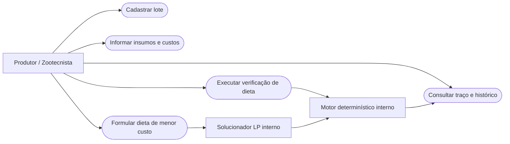
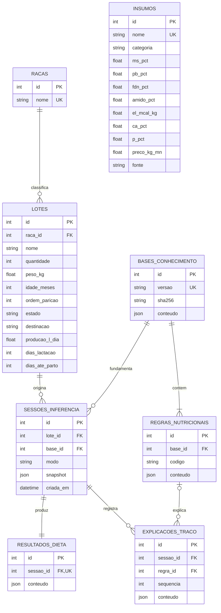

# Modelagem e decisões de arquitetura

## Casos de uso

## DER implementado

Itens de entrada e saída e seus insumos são armazenados como snapshots JSON na sessão e no resultado, sem FK para o catálogo mutável. Isso permite preservar composição, preços e quantidades históricos com poucas tabelas no MVP. A evolução para tabelas de itens pode ser feita por migração; não se deve reconstruir custos históricos a partir do preço atual do catálogo.

## Paleta e semântica

| Papel | HEX | Uso |
|---|---|---|
| Primária | `#14532D` | Ações e identidade |
| Secundária | `#0F766E` | Links e foco |
| Background | `#F5F7F6` | Área de trabalho |
| Superfície | `#FFFFFF` | Cartões e formulários |
| Texto | `#0F172A` | Conteúdo |
| Sucesso | `#166534` | Restrição atendida |
| Alerta | `#92400E` | Lacuna de dados / escopo |
| Erro | `#B91C1C` | Erro de entrada |

Estados sempre incluem texto, não apenas cor. Layout responsivo, rótulos em campos e foco de teclado visível. Nenhum dado nutricional é inferido pela aparência da interface.

## Evolução e manutenção

- Não alterar faixas diretamente no frontend ou no solver; publicar versão nova do JSON.
- Não aplicar coeficientes de raça/peso/idade sem fonte e revisão técnica.
- Antes de adicionar nutriente, estender DTO, composição, cálculo, compilação LP, traço e testes de conversão.
- Mudanças de esquema em banco existente exigem migração; `create_all` apenas cria tabelas ausentes.
- Autenticação por bcrypt/JWT em cookie HttpOnly, confirmação em `/api/auth/me` e revogação no logout. Consultas e gravações operacionais recebem escopo de `usuario_id`; o catálogo global é somente leitura. Migração aditiva preserva registros antigos sem proprietário, que permanecem inacessíveis às contas comuns. O SQLite continua exigindo revisão de concorrência antes de ampliar a implantação.
