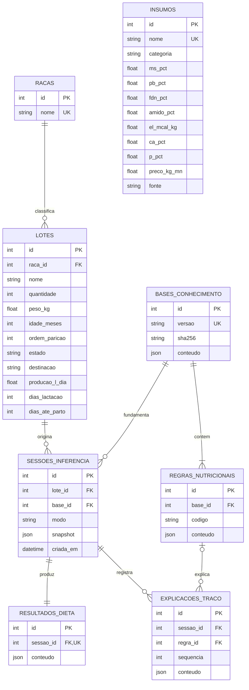

# Modelagem e decisões de arquitetura

## Casos de uso

## DER implementado

Itens de entrada e saída e seus insumos são armazenados como snapshots JSON na sessão e no resultado, sem FK para o catálogo mutável. Isso permite preservar composição, preços e quantidades históricos com poucas tabelas no MVP. A evolução para tabelas de itens pode ser feita por migração; não se deve reconstruir custos históricos a partir do preço atual do catálogo.

## Paleta e semântica

| Papel | HEX | Uso |
|---|---|---|
| Primária | `#14532D` | Ações e identidade |
| Secundária | `#0F766E` | Links e foco |
| Background | `#F5F7F6` | Área de trabalho |
| Superfície | `#FFFFFF` | Cartões e formulários |
| Texto | `#0F172A` | Conteúdo |
| Sucesso | `#166534` | Restrição atendida |
| Alerta | `#92400E` | Lacuna de dados / escopo |
| Erro | `#B91C1C` | Erro de entrada |

Estados sempre incluem texto, não apenas cor. Layout responsivo, rótulos em campos e foco de teclado visível. Nenhum dado nutricional é inferido pela aparência da interface.

## Evolução e manutenção

- Não alterar faixas diretamente no frontend ou no solver; publicar versão nova do JSON.
- Não aplicar coeficientes de raça/peso/idade sem fonte e revisão técnica.
- Antes de adicionar nutriente, estender DTO, composição, cálculo, compilação LP, traço e testes de conversão.
- Mudanças de esquema em banco existente exigem migração; `create_all` apenas cria tabelas ausentes.
- Autenticação por Passlib/bcrypt e PyJWT em cookie HttpOnly, confirmação em `/api/auth/me` e revogação no logout. Consultas e gravações operacionais recebem escopo de `usuario_id`; o catálogo global é somente leitura. Migração aditiva preserva registros antigos sem proprietário, que permanecem inacessíveis às contas comuns. O SQLite continua exigindo revisão de concorrência antes de ampliar a implantação.

## Base v0.2.0 - recalibração T2

A família da base é **v0.2.0**. O identificador publicado desta revisão é `0.2.0+recalibracao.1`, no arquivo `backend/rules/base_v0.2.0.json`. O conteúdo original 0.2.0 permanece em `base_v0.2.0_original.json`; o seed cria outro registro, preservando sessões e hashes históricos. Não substitua a base anterior no banco.

O motor identifica e relata conjuntamente quais restrições nutricionais foram violadas/conflitantes no modelo estrito, sem relaxá-las automaticamente. Em uma formulação inviável não existe dieta final da qual medir violações: o diagnóstico informa restrições conjuntamente incompatíveis, incluindo limites dos insumos. A certificação do conjunto irredutível depende de concluir o diagnóstico dentro do orçamento numérico; ele não precisa ser único nem ter cardinalidade mínima.

A formulação para o período de transição pré-parto (Close-Up) está intencionalmente bloqueada nesta versão (escopo de evolução futura), sendo suportados apenas os perfis de lactação e seca distante. A lactação suportada pelos perfis continua exigindo DEL >= 60 e os manejos declarados; a estimativa de CMS não amplia automaticamente esse escopo.

Desempenho: execução local determinística em tempo real, com limites explícitos de duração. Não há medição que sustente conclusão do wizard em menos de 30 segundos nem garantia de latência em qualquer equipamento.

SHA-256: **Hash de Validação de Integridade e Rastreabilidade do Conteúdo da Base de Conhecimento**. Não é assinatura digital autenticada. Os registros históricos têm triggers de proteção, mas um administrador com controle total do banco pode alterar registros e hashes.

### Hipóteses e limites da recalibração

- Idade <= 36 meses OU ordem de parição = 1 ativa uma única reserva de crescimento. O acréscimo é 10% da PB e da EL de mantença informadas, por animal/dia, com fonte obrigatória. Para PB, `delta_%MS = 0.10 * mantenca_pb_kg_dia / CMS * 100`; para EL, `delta_Mcal_kgMS = 0.10 * mantenca_el_mcal_dia / CMS`. Não se confunde mantença com a dieta inteira. Sem entradas/fonte, o sistema retorna dados insuficientes. Os valores devem representar o grupo analisado; não há cálculo fisiológico automático da mantença nem garantia de preservação de ECC.
- `destinacao` preserva leite/reprodução/dupla aptidão. O novo campo `destinacao_economica` separa leite fluido de queijo artesanal. Leite fluido mantém os limites; queijo em lactação aplica pisos experimentais PB 18% MS e FDN de volumosos 21% MS. O segundo piso mede contribuição de FDN, sem certificar qualidade da fibra. O sistema não prediz sólidos nem rendimento de queijo.
- CMS Holandesa em lactação preserva a equação 2-1 NASEM 2021 (DEL 1–368). Para outras raças, há adaptação experimental: fator Holandesa 1, Girolando 0.95, Gir Leiteiro 0.88 e Jersey 1.05 sobre `PV**0.75`; reconverte-se `PV_equivalente = (fator * PV**0.75)**(1/0.75)` para o termo linear de peso da equação. Essa transformação é uma escolha de implementação solicitada, sem validação NASEM para essas raças.
- Seca distante: faixa CMS `PV * [0.0197, 0.021]`, com ponto médio `PV * 0.02035`; não aplica fator racial nem equação de lactação. Não solicita produção/energia do leite ou DEL. Até 21 dias para o parto, bloqueia a estimativa e a formulação.
- CF das fontes: laboratório 1.00, tabela 0.85, estimativa de campo 0.70. São pesos de política solicitados, sem calibração empírica nem verificação automática de laudos. Valores explícitos menores são aceitos; maiores que o teto da fonte são rejeitados.
- Composição usa média dos CF ponderada pelos kg MS dos insumos realmente utilizados. Insumo com quantidade zero não participa. O CF global permanece limitado pelas premissas, regras, ajustes e consumo; resultados inviáveis/bloqueados não recebem CF diagnóstico. Não se altera a álgebra MYCIN das regras para apresentar uma média como probabilidade.

A revisão zootécnica permanece pendente. Essas mudanças não garantem nota de banca ou eficácia comercial. Referência do domínio original de CMS: https://www.ncbi.nlm.nih.gov/books/NBK600610/. Os coeficientes adicionais e os pisos de queijo vieram da solicitação da equipe, sem atribuição bibliográfica fictícia.

## Projeções relacionais e compatibilidade da consolidação

Os nomes de domínio `Usuario` e `Insumo` compartilham os mapeamentos `UserAccount`/`InsumoAlimentar`, sem criar tabelas duplicadas nem alterar o filtro de tenant. `Lote.raca` é o nome obtido pela relação com `racas`, preservando a FK `raca_id`. Sinônimos de atributos e aliases de entrada aceitam os nomes solicitados; a serialização existente é mantida para compatibilidade.

`tmr_habilitado` é persistido no lote. Novas sessões gravam `base_versao`, `base_hash_sha256` e `cf_global`, além do snapshot integral. Leituras conferem essas projeções contra snapshot/resultado auditados. A migração aditiva não reescreve sessões antigas protegidas: suas colunas novas permanecem nulas, e a API resolve os metadados pelo snapshot congelado. A base mantém o identificador exato da revisão publicada, sem rebatizar resultados antigos como v0.2.0.

A proteção global de dependência fecha o perímetro de `/api/*`; `get_current_user` valida JWT e revogação, enquanto `get_scoped_db` aplica o usuário às consultas/gravações. Os dois endpoints de entrada são as únicas exceções de autenticação. Consulte [o relatório](CONSOLIDACAO-FINAL.md).
