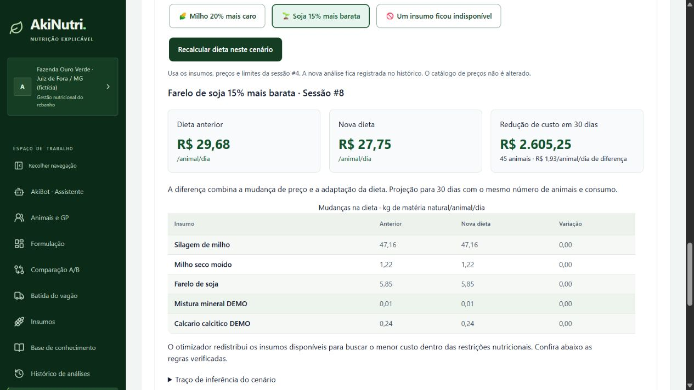

# Validação final — 21/10/2026

Entrega local para demonstração do hackathon. Sem publicação externa. O banco da aplicação foi preservado: os testes automatizados usam bancos temporários por caso e a validação no navegador usou uma instância separada em `localhost:8011`, com dados fictícios.

## Correções encerradas

- O AkiBot tem página dedicada em `/dashboard/akibot`, acessível pela sidebar e protegida por autenticação. A sidebar mantém rolagem sem exibir a barra; o card da propriedade acomoda nomes longos.
- O atalho de lactação escolhe um insumo por tipo, priorizando composição completa. Um botão separado inclui minerais com composição completa, sem preencher nutrientes ausentes artificialmente.
- A formulação e a verificação com grupo usam os mesmos fatos agregados. Auditoria, custo do grupo, comparação A/B e relatório de batida respeitam o número de animais desse grupo.
- A auditoria reconstitui o perfil a partir dos fatos congelados do grupo, mesmo quando diferem do lote. Alterar o cadastro posteriormente não modifica o resultado histórico.
- Estimativas NASEM incompatíveis com peso, DEL, fase, raça, ECC ou paridade do contexto são rejeitadas. Voltar no wizard e pedir outra estimativa exige nova seleção de grupo.
- Abrir uma sessão restaura lote, modo, CMS, grupo, manejo, preços, limites e quantidades no formulário.
- Repetir uma tentativa após falha na abertura de uma sessão salva não gera outra formulação com o mesmo pedido no wizard ou simulador.
- Os cenários de preço salvam outra análise, preservam o catálogo e a sessão original, apresentam quantidades e custos comparáveis e omitem projeções em caso de inviabilidade ou mudança de contexto.

## Testes automatizados

Resultado da execução integral de `tools/verify.ps1`:

| Verificação | Resultado |
|---|---|
| Black | 25 arquivos conferidos, sem alterações pendentes |
| Backend / pytest | 87 testes aprovados |
| Frontend / Vitest | 48 testes aprovados em 9 arquivos |
| Prettier | Todos os arquivos de `src` aprovados |
| Build Vite | Produção gerada com sucesso |

O script terminou com código de saída 0.

O comando de entrega é executado na raiz `akinutri`:

```powershell
.\tools\verify.ps1
```

Etapas: Black, pytest com bancos temporários isolados, Prettier, Vitest e build Vite de produção. O script interrompe na primeira falha. Pré-requisitos: ambiente virtual com `backend/requirements-dev.txt` e dependências de `frontend/package-lock.json` instaladas.

As regressões novas cobrem grupos com parâmetros diferentes do lote, reabertura e auditoria de sessões, igualdade entre formulação e verificação, custo agregado, batida, comparação entre grupos incompatíveis, mudanças de preço, retirada de insumos, preservação do catálogo, composição completa no atalho e recuperação de falhas de carregamento.

Há um aviso de depreciação da integração Starlette/AnyIO sobre `BlockingPortal`. Ele não representa falha funcional; a atualização das dependências deve ser feita em uma revisão própria, com execução da suíte completa.

## Conferência no navegador

Fluxo executado com o build servido pelo próprio FastAPI:

1. Login com a conta fictícia da instância de QA.
2. Abertura do AkiBot pela sidebar, perfil de alta produção e estimativa NASEM.
3. Seleção de insumos padrão e minerais completos, sem incluir as cópias particulares com Ca/P ausentes.
4. Seleção do grupo de 45 animais, com 630 kg, DEL 110 e 32 L/dia, diferente do perfil inicial de 650 kg, DEL 100 e 35 L/dia. O CMS foi recalculado para aproximadamente 23,03 kg MS/animal/dia.
5. Formulação válida e redirecionamento ao resultado, com regras atendidas e custo de aproximadamente R$ 29,68/animal/dia.
6. Milho +20%: nova sessão válida com aproximadamente R$ 29,99/animal/dia e acréscimo de R$ 412,43 em 30 dias para o grupo.
7. Soja −15%: nova sessão válida com aproximadamente R$ 27,75/animal/dia e redução de R$ 2.605,25 em 30 dias para o grupo.
8. Soja indisponível: diagnóstico de inviabilidade, sem projeção de economia.
9. Abertura do resultado completo do cenário e geração de duas batidas/dia: aproximadamente 1.225,729 kg MN/batida para os 45 animais.

Os valores são de dados fictícios, exibidos com arredondamento. Os cálculos e registros mantêm a precisão do motor. Nesta amostra, as mudanças de preço mantiveram a mesma solução de quantidades; a diferença financeira decorre do preço alterado, sem alegar uma substituição que não ocorreu.



## Operação da entrega

Depois da validação, execute `./start.ps1` na raiz do projeto e acesse `http://localhost:8000`. O backend serve o build estático e a documentação Swagger local em `/docs`. A autenticação requer o segredo local configurado conforme o README.

A instância temporária de QA não faz parte da operação normal. Nenhuma dependência de LLM, serviço externo ou token de IA foi adicionada.

## Limites da validação

A conferência visual desta entrega foi em navegador desktop. A suíte automatizada não certifica acessibilidade integral nem mede a meta de conclusão do wizard em 30 segundos. Os perfis nutricionais continuam sendo modelos simplificados de referência; o sistema não cobre pré-parto próximo nem constitui validação de prescrição nutricional.
